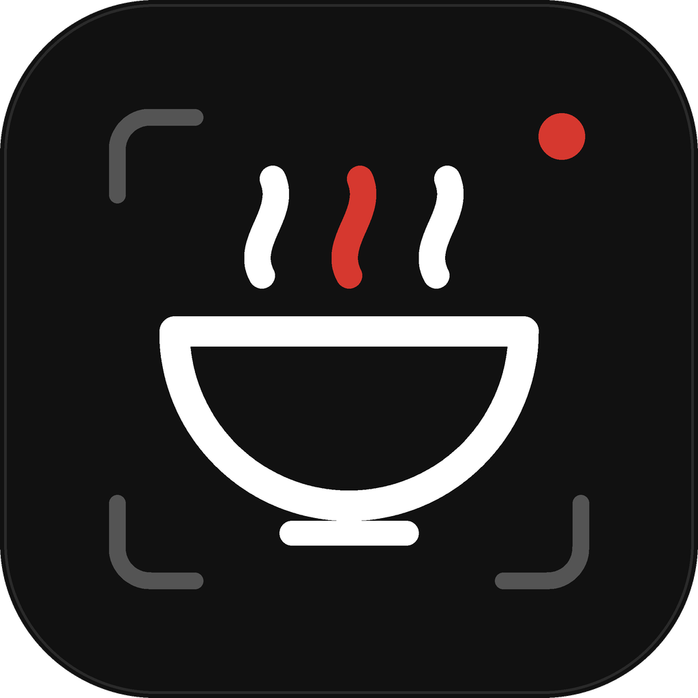
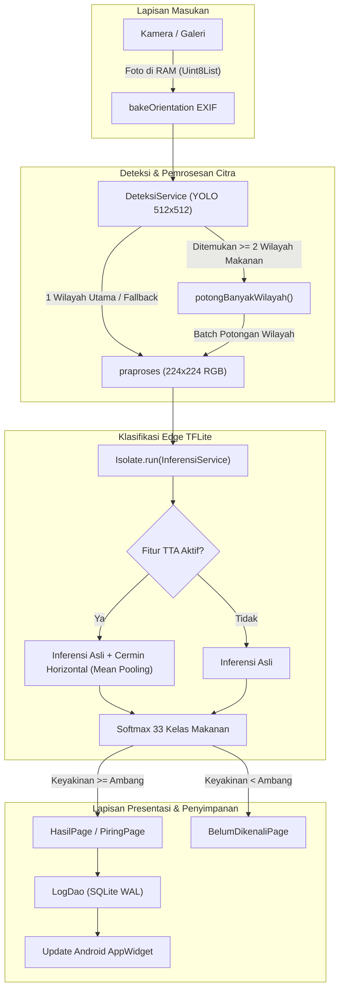

<div align="center">

  

  # FoodCal AI

  **Estimasi Kalori & Nutrisi Makanan Cerdas Berbasis On-Device Machine Learning**  
  *100% Luring · Privasi Terjaga Tanpa Izin Internet · Deteksi Piring Multi-Makanan*

  <br/>

  [](https://flutter.dev)
  [](https://dart.dev)
  [](https://www.tensorflow.org/lite)
  [](https://sqlite.org)
  [](#pengujian--kualitas-kode)
  [](#privasi--keamanan-data)

</div>

---

## 📖 Tentang FoodCal AI

**FoodCal AI** adalah aplikasi Android pelacak nutrisi harian yang memanfaatkan kecerdasan buatan (*Edge AI*) langsung di ponsel pengguna. Berbeda dengan aplikasi pelacak kalori konvensional yang mengunggah foto makanan ke peladen awan (*cloud*), FoodCal AI menjalankan seluruh rangkaian inferensi visi komputer—mulai dari deteksi wilayah piring, klasifikasi makanan nusantara, hingga kalkulasi makronutrisi—secara **sepenuhnya luring (*offline*)**.

Aplikasi ini tidak memerlukan akun, tidak membutuhkan koneksi internet, dan **tidak pernah menyimpan foto pengguna ke memori penyimpanan ponsel**, menjadikannya solusi pelacak nutrisi yang aman, privat, dan responsif.

---

## ✨ Fitur Utama

<table>
  <tr>
    <td width="50%">
      <h3>🥗 Deteksi Multi-Makanan (Piring Pintar)</h3>
      Didukung model <b>YOLO (512×512)</b> untuk mendeteksi berbagai jenis makanan di atas satu piring secara bersamaan, memotong wilayah makanan secara cerdas, dan menjumlahkan total kalori hidangan secara otomatis.
    </td>
    <td width="50%">
      <h3>🧠 On-Device TFLite Classifier</h3>
      Pilihan dua model klasifikasi gizi 33 kelas:
      <ul>
        <li><b>Bawaan (Default):</b> EfficientNet-B0 FP16 (9,4 MB) untuk akurasi maksimal.</li>
        <li><b>Hemat:</b> MobileNetV3-Small FP16 (2,5 MB) untuk ponsel ramah memori (< 3 GB RAM).</li>
      </ul>
    </td>
  </tr>
  <tr>
    <td width="50%">
      <h3>⚖️ Preset Porsi & Satuan Alami</h3>
      Pilihan porsi cepat berbasis porsi referensi standar (<i>Setengah, Biasa, Besar</i>) dengan satuan alami Indonesia (<i>tusuk</i> untuk sate, <i>butir</i> untuk telur, <i>mangkuk</i> untuk soto/bakso, <i>potong</i> untuk sushi/pizza).
    </td>
    <td width="50%">
      <h3>🔄 Koreksi Model & Catat Manual</h3>
      Fitur <i>"Bukan ini? Ganti makanan"</i> menampilkan kandidat alternatif model secara transparan. Mendukung pencatatan manual untuk makanan rumahan di luar basis data model.
    </td>
  </tr>
  <tr>
    <td width="50%">
      <h3>📱 Widget Layar Utama Android</h3>
      Menyediakan <i>AppWidget</i> interaktif Android native:
      <ul>
        <li><b>Widget 4×2:</b> Cincin kalori harian, sisa kalori, dan tombol pintas kamera langsung.</li>
        <li><b>Widget 2×2:</b> Tampilan ringkas persentase target kalori hari ini.</li>
      </ul>
    </td>
    <td width="50%">
      <h3>📊 Riwayat, Grafik & Ekspor CSV</h3>
      Grafik tren asupan kalori 7 hari & 30 hari interaktif dengan visualisasi makro (Protein, Lemak, Karbohidrat). Data riwayat dapat diekspor ke berkas <b>CSV</b> kapan saja.
    </td>
  </tr>
</table>

---

## 🏗️ Arsitektur & Alur Inferensi



---

## 🍲 Cakupan 33 Kelas Makanan

FoodCal AI dilatih khusus mengenali makanan favorit Indonesia serta hidangan internasional populer:

<details>
<summary><b>Klik untuk melihat daftar lengkap 33 kelas makanan</b></summary>
<br/>

| ID | Nama Makanan | Kategori | Satuan Alami | Porsi Ref. |
|:--:|:---|:---|:---:|:---:|
| 0 | Ayam Goreng | Indonesia | porsi | 150 g |
| 1 | Ayam Pop | Indonesia (Padang) | porsi | 150 g |
| 2 | Bakso | Indonesia | mangkuk | 300 g |
| 3 | Bebek Betutu | Indonesia (Bali) | porsi | 200 g |
| 4 | Caesar Salad | Internasional | porsi | 150 g |
| 5 | Dendeng Batokok | Indonesia (Padang) | porsi | 100 g |
| 6 | Donat | Internasional | buah | 60 g |
| 7 | Pangsit (*Dumplings*) | Internasional | buah | 20 g |
| 8 | Nasi Goreng (Barat) | Internasional | porsi | 300 g |
| 9 | Gado-Gado | Indonesia | porsi | 200 g |
| 10 | Gudeg | Indonesia (Jawa) | porsi | 150 g |
| 11 | Gulai Ikan | Indonesia (Padang) | mangkuk | 150 g |
| 12 | Gulai Tambusu | Indonesia (Padang) | mangkuk | 150 g |
| 13 | Gulai Tunjang | Indonesia (Padang) | mangkuk | 150 g |
| 14 | Hamburger | Internasional | buah | 200 g |
| 15 | Es Krim | Internasional | scoop | 60 g |
| 16 | Nasi Goreng | Indonesia | porsi | 250 g |
| 17 | Omelet | Internasional | porsi | 120 g |
| 18 | Pad Thai | Internasional | porsi | 300 g |
| 19 | Pancake | Internasional | lembar | 75 g |
| 20 | Pempek | Indonesia (Palembang) | porsi | 200 g |
| 21 | Pizza | Internasional | potong | 100 g |
| 22 | Ramen | Internasional | mangkuk | 500 g |
| 23 | Rawon | Indonesia (Jawa Timur) | mangkuk | 300 g |
| 24 | Rendang | Indonesia (Padang) | porsi | 100 g |
| 25 | Sate | Indonesia | tusuk | 15 g |
| 26 | Soto | Indonesia | mangkuk | 300 g |
| 27 | Lumpia (*Spring Rolls*) | Internasional | porsi | 120 g |
| 28 | Steak | Internasional | porsi | 200 g |
| 29 | Sushi | Internasional | potong | 30 g |
| 30 | Telur Balado | Indonesia (Padang) | butir | 55 g |
| 31 | Telur Dadar | Indonesia | butir | 60 g |
| 32 | Nasi Putih | Indonesia | porsi | 150 g |

</details>

---

## 🔒 Privasi & Keamanan Data

Aplikasi ini dibangun dengan komitmen privasi ketat:

> [!IMPORTANT]
> - **Nol Izin Internet:** Berkas `AndroidManifest.xml` sama sekali tidak memuat `<uses-permission android:name="android.permission.INTERNET"/>`. Tidak ada data yang dapat dikirim keluar dari ponsel.
> - **Foto Ramah Memori (Ephemeral):** Foto makanan hanya dibaca ke dalam RAM (array `Uint8List`) untuk keperluan inferensi tensor. Begitu hasil kalkulasi nutrisi ditampilkan, objek foto langsung dibersihkan oleh garbage collector tanpa pernah disimpan ke penyimpanan berkas/galeri.
> - **Penyimpanan Lokal Terenkapsulasi:** Basis data riwayat (`foodcal.db`) disimpan dalam direktori privat aplikasi (`app_flutter/`) yang tidak dapat diakses oleh aplikasi lain pada sistem operasi Android.

---

## 📁 Struktur Repositori

```text
aplikasi_foodcal/
├── android/                  # Proyek Android native (AppWidget Provider & Updater Kotlin)
│   └── app/src/main/
│       ├── kotlin/           # FoodCalWidgetUpdater, 4x2 Provider, 2x2 Provider
│       └── res/              # Tata letak widget RemoteViews XML
├── assets/
│   ├── data/                 # Basis data SQLite bawaan (foodcal.db v2)
│   ├── fonts/                # Tipografi Poppins (Google Fonts OFL)
│   ├── logo/                 # Aset logo vektor & ikon aplikasi
│   └── models/               # Model TFLite (EfficientNet, MobileNetV3, YOLO)
├── docs/                     # Dokumen PRD dan Design Specification
├── lib/
│   ├── app/                  # Tema, Router, MainShell navigasi, State Providers
│   ├── core/                 # Formatter angka, satuan, tanggal Indonesia
│   ├── data/                 # Database SQLite, DAO Kelas/Log/Pengaturan, Repositori
│   ├── domain/               # Model entitas, Rekap harian, Kalkulator gizi
│   ├── features/
│   │   ├── beranda/          # Layar ringkasan harian & cincin target kalori
│   │   ├── catatan/          # Catatan harian, grafik fl_chart, ubah entri
│   │   ├── hasil/            # Hasil inferensi, sheet koreksi, lembar porsi
│   │   ├── kamera/           # Antarmuka kamera luring & pemilih galeri
│   │   ├── onboarding/       # Setup target kalori awal pengguna
│   │   ├── pengaturan/       # Pengaturan model ML, ambang keyakinan, TTA
│   │   ├── piring/           # Susunan hidangan multi-makanan
│   │   └── profil/           # Profil pengguna, saran BMR/Mifflin, pasang widget
│   ├── services/             # YOLO detector, TFLite inference, potong citra, ekspor CSV
│   └── widgets/              # Komponen UI: tombol, kartu, nav pill, dialog
└── test/                     # Unit test & widget test (72 kasus pengujian)
```

---

## 🚀 Memulai (Panduan Pengembangan)

### Prasyarat
- **Flutter SDK**: `>= 3.24.0` (Saluran `stable`)
- **Dart SDK**: `>= 3.5.0`
- **Android Studio / VS Code** dengan ekstensi Flutter & Dart
- **JDK**: Java 17

### Langkah Pemasangan

1. **Kloning Repositori:**
   ```bash
   git clone https://github.com/USERNAME/aplikasi_foodcal.git
   cd aplikasi_foodcal
   ```

2. **Pasang Dependensi:**
   ```bash
   flutter pub get
   ```

3. **Verifikasi Lingkungan & Uji Otomatis:**
   ```bash
   flutter analyze
   flutter test
   ```

4. **Jalankan pada Perangkat Android / Emulator:**
   ```bash
   flutter run
   ```

---

## 📦 Membangun Berkas APK Rilis

Untuk menghasilkan berkas APK rilis siap pasang:

```bash
# Opsi 1: Satu APK universal
flutter build apk --release

# Opsi 2 (Disarankan): APK teroptimasi per arsitektur CPU (ukuran jauh lebih ringkas ~24 MB)
flutter build apk --release --split-per-abi
```

Hasil berkas biner APK akan tersedia di:  
`build/app/outputs/flutter-apk/app-arm64-v8a-release.apk`

---

## 🧪 Pengujian & Kualitas Kode

Aplikasi ini dilengkapi pengujian unit dan pengujian widget yang komprehensif:

| Kategori Pengujian | Target Cakupan | Status |
|:---|:---|:---:|
| **Analisis Kode Statis** | Linter `flutter_lints` & pedoman gaya kode | `No issues found!` |
| **Kalkulator Gizi** | Presisi konversi makro per 100g, rasio porsi, batas min/max | ✅ Lulus |
| **Deteksi & Citra** | Penguraian kotak YOLO, NMS, orientasi EXIF | ✅ Lulus |
| **Basis Data & Migrasi** | Skema SQLite v1 $\to$ v2, integritas data log makan | ✅ Lulus |
| **Widget & Antarmuka** | Tampilan 360dp, skala font 1.15×, mode terang/gelap | ✅ Lulus |
| **Total Test Suite** | **72 pengujian otomatis** | **100% Lulus** |

---

## 🛠️ Tumpukan Teknologi

- **Framework:** [Flutter](https://flutter.dev) (Dart)
- **State Management:** [Flutter Riverpod](https://riverpod.dev)
- **Deep Learning Runtime:** [tflite_flutter](https://pub.dev/packages/tflite_flutter) (TensorFlow Lite C API)
- **Database Engine:** [sqflite](https://pub.dev/packages/sqflite) dengan WAL mode
- **Visualisasi Data:** [fl_chart](https://pub.dev/packages/fl_chart)
- **Manipulasi Citra:** [image](https://pub.dev/packages/image)
- **Android Native:** Kotlin, `AppWidgetProvider`, `RemoteViews`

---

## 📄 Lisensi

Didistribusikan di bawah lisensi **MIT License**. Lihat berkas [LICENSE](LICENSE) untuk informasi lebih lanjut.

---

<div align="center">
  <sub>Dikembangkan dengan fokus pada akurasi, privasi data, dan kemudahan pelacakan nutrisi harian.</sub>
</div>
