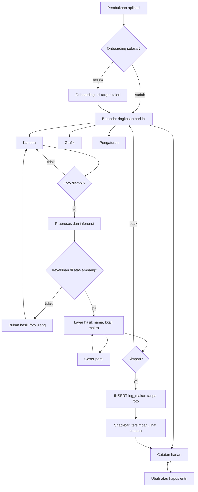

# Product Requirements Document
## FoodCal AI: Estimasi Kalori Makanan Berbasis Citra pada Aplikasi Mobile Flutter dengan Inferensi TFLite Luring

| Item | Keterangan |
|---|---|
| Versi dokumen | 1.1 |
| Tanggal | 28 Oktober 2026 |
| Status | Draf untuk pengembangan Tahap 6 |
| Mata kuliah | PJBL Pembelajaran Mesin, Kelas A |
| Kelompok | Kelompok 4 |
| Nama penyusun | |
| NIM | |
| Dosen pengampu | |

---

## 1. Ringkasan Produk

FoodCal AI adalah aplikasi Android berbasis Flutter yang memperkirakan kalori makanan dari satu foto. Seluruh proses berjalan di perangkat tanpa koneksi internet: kamera mengambil gambar, model TensorFlow Lite mengenali satu dari 32 kelas makanan, lalu kandungan gizi kelas tersebut diambil dari basis data luring dan dikalikan dengan porsi yang dipilih pengguna.

Versi 1.0 menambahkan fungsi yang belum ada pada purwarupa penelitian: **pencatatan harian**. Setelah hasil keluar, pengguna dapat menekan Simpan, dan aplikasi menyimpan nama makanan, porsi, kalori, serta waktu makan. Foto tidak disimpan, tidak diunggah, dan tidak meninggalkan memori perangkat.

### 1.1 Masalah yang diselesaikan

- Pencatatan kalori manual memerlukan pengguna mencari nama makanan dan menimbang porsi, sehingga kepatuhan mencatat turun setelah beberapa hari.
- Aplikasi sejenis umumnya memerlukan koneksi internet dan mengunggah foto ke server, yang menjadi masalah privasi dan biaya kuota.
- Estimasi porsi sering menjadi sumber galat terbesar, bukan pengenalan jenis makanannya.

### 1.2 Tujuan yang terukur

| Tujuan | Ukuran keberhasilan | Cara verifikasi |
|---|---|---|
| Mengenali makanan dari foto | Akurasi top-1 minimal 0,85 pada 4.836 citra uji | Evaluasi model yang sudah dilakukan, 0,90 tercapai |
| Menyimpan catatan harian | 100 persen entri tersimpan setelah aplikasi ditutup | Uji unit basis data dan uji manual 20 entri |
| Menjaga privasi | Nol berkas foto tertinggal di penyimpanan | Pemeriksaan folder aplikasi sebelum dan sesudah pemakaian |
| Berjalan luring | Seluruh alur utama berfungsi pada mode pesawat | Uji manual 10 skenario tanpa data seluler |
| Kecepatan | Inferensi di bawah 500 ms pada perangkat kelas menengah | Pengukuran dengan trace di dua perangkat fisik |

---

## 2. Pengguna Sasaran dan Skenario

### 2.1 Persona utama

| Persona | Kebutuhan | Rasa sakit saat ini |
|---|---|---|
| Mahasiswa yang mengatur berat badan | Mencatat makan siang dan malam dengan cepat di sela kuliah | Malas mengetik nama makanan dan menimbang porsi setiap hari |
| Pekerja kantoran dengan waktu makan tidak teratur | Melihat total kalori hari ini sebelum memutuskan makan berikutnya | Tidak tahu berapa kalori yang sudah masuk sampai akhir hari |
| Pengguna yang sadar privasi | Tidak ingin foto makanannya tersimpan atau diunggah | Aplikasi lain meminta akses galeri dan mengunggah foto ke server |

### 2.2 Alur pengguna utama

Ambil foto, tunggu hasil, sesuaikan porsi, simpan, lihat total harian. Alur ini harus selesai dalam empat ketukan: tombol kamera, tombol jepret, penggeser porsi (opsional), tombol Simpan.

---

## 3. Ruang Lingkup

### 3.1 Termasuk dalam versi 1.0

- Pengenalan 32 kelas makanan (10 masakan Indonesia, 8 masakan Padang, 14 hidangan internasional).
- Perhitungan kalori dan makronutrien dari basis data luring per 100 gram.
- Penyesuaian porsi dalam gram dan kelipatan porsi referensi.
- Pencatatan harian tanpa foto: nama makanan, porsi, kalori, waktu, tingkat keyakinan.
- Riwayat harian, total kalori hari ini, dan target kalori harian.
- Grafik tujuh hari terakhir.
- Ubah dan hapus entri catatan.
- Ekspor catatan ke CSV.
- Ambang keyakinan: prediksi di bawah ambang ditolak dengan saran memotret ulang.

### 3.2 Di luar ruang lingkup

- Akun pengguna, sinkronisasi awan, dan pemakaian lintas perangkat.
- Menyimpan atau menampilkan kembali foto makanan.
- Pemindaian barcode dan basis data produk kemasan.
- Perhitungan kebutuhan kalori otomatis dari antropometri (hanya saran, diisi manual).
- Deteksi banyak makanan dalam satu foto (satu foto, satu makanan).
- Bahasa selain Indonesia.

---

## 4. Dasar Keputusan Teknis dari Hasil Eksperimen

Seluruh keputusan di bawah diambil dari hasil pengukuran Tahap 3 sampai Tahap 5, bukan dari asumsi.

| Keputusan | Pilihan | Alasan berbasis angka |
|---|---|---|
| Model bawaan | EfficientNet-B0 FP16, 9,67 MB | Akurasi 0,9001, MAE 15,8 kkal, 90 ms per citra di CPU laptop. Versi FP32 sama akurat tetapi dua kali lebih besar |
| Model hemat | MobileNetV3-Small FP16, 2,77 MB | Akurasi 0,8605, MAE 21,4 kkal, 32 ms. Untuk perangkat dengan RAM di bawah 3 GB |
| Kuantisasi INT8 | Tidak dipakai | Akurasi jatuh ke 0,54 sampai 0,64 pada tiga model, dan delegate XNNPACK menolak graf int8 sehingga latensi mencapai 1.392 ms |
| Penggabungan dua backbone | Tidak dipakai di aplikasi | Akurasi 0,9001, sama dengan EfficientNet-B0 tunggal, tetapi berkas 14,86 MB dan 1,4 kali lebih lambat |
| TTA cermin | Opsional, mati secara bawaan | Menambah 0,18 poin akurasi dan memperbaiki kalibrasi (ECE 0,0493), dengan biaya dua kali inferensi |
| Ambang keyakinan | 0,60, dapat diubah di pengaturan | ECE model 0,0493 sampai 0,0569, sehingga keyakinan di bawah 0,60 tidak layak ditampilkan sebagai hasil pasti |
| Sumber gizi | `nutrition_lookup.csv`, 32 kelas | TKPI 2017 untuk masakan Indonesia dan Padang, USDA FNDDS 2024 untuk hidangan internasional, dengan jejak sumber per kelas |

---

## 5. Kebutuhan Fungsional

Setiap kebutuhan memiliki kode, prioritas (M wajib, S sebaiknya, C opsional), dan kriteria penerimaan yang dapat diuji.

| Kode | Fitur | Prioritas | Kriteria penerimaan |
|---|---|---|---|
| FR-01 | Ambil foto dari kamera | M | Kamera terbuka kurang dari 1 detik, hasil jepretan disimpan di memori sebagai larik piksel, bukan berkas |
| FR-02 | Pilih foto dari galeri | M | Pengguna dapat memilih satu foto, aplikasi tidak meminta akses ke seluruh galeri |
| FR-03 | Praproses citra | M | Potong persegi di tengah, ubah ukuran ke 224 x 224, nilai piksel 0 sampai 255, sesuai pipeline pelatihan |
| FR-04 | Inferensi TFLite | M | Berjalan di isolate terpisah, antarmuka tidak membeku, hasil berupa 32 probabilitas |
| FR-05 | Tampilan hasil | M | Menampilkan nama makanan, persentase keyakinan, kalori per porsi, protein, lemak, karbohidrat |
| FR-06 | Penolakan prediksi lemah | M | Bila keyakinan tertinggi di bawah ambang, aplikasi menampilkan pesan bukan hasil, dengan tombol foto ulang |
| FR-07 | Penyesuaian porsi | M | Penggeser 50 sampai 300 gram, nilai awal sama dengan porsi referensi kelas, kalori dan makro dihitung ulang seketika |
| FR-08 | Simpan ke catatan harian | M | Tombol Simpan menulis satu baris ke basis data berisi nama makanan, porsi, kalori, keyakinan, dan waktu. Foto tidak ditulis ke penyimpanan |
| FR-09 | Konfirmasi simpan | M | Setelah Simpan, muncul pesan singkat dan tombol Lihat Catatan, entri langsung terlihat di daftar hari ini |
| FR-10 | Catatan harian | M | Daftar entri hari ini diurutkan waktu, dengan total kalori, protein, lemak, dan karbohidrat di bagian atas |
| FR-11 | Ubah entri | M | Porsi dapat diubah dan kalori dihitung ulang, waktu dapat digeser dalam hari yang sama |
| FR-12 | Hapus entri | M | Menghapus satu entri memerlukan konfirmasi, total harian langsung menyesuaikan |
| FR-13 | Target kalori harian | M | Diisi saat pertama kali membuka aplikasi, dapat diubah kapan saja, ditampilkan sebagai cincin kemajuan |
| FR-14 | Grafik tujuh hari | S | Diagram batang atau garis kalori tujuh hari terakhir, dengan garis target |
| FR-15 | Ekspor CSV | S | Berkas CSV berisi tanggal, waktu, makanan, porsi, kalori, dibagikan lewat lembar berbagi sistem |
| FR-16 | Riwayat lebih dari satu hari | S | Dapat menelusuri tanggal sebelumnya lewat pemilih tanggal, tanpa batas jumlah hari |
| FR-17 | Pengaturan | S | Mengubah ambang keyakinan, menyalakan TTA cermin, memilih model hemat atau bawaan, menghapus seluruh data |
| FR-18 | Saran target kalori | C | Menampilkan saran berdasarkan berat, tinggi, usia, dan jenis kelamin memakai rumus Mifflin-St Jeor, pengguna tetap dapat menimpanya |
| FR-19 | Widget ringkasan | C | Widget layar utama menampilkan sisa kalori hari ini |

---

## 6. Kebutuhan Non-Fungsional

| Aspek | Target | Catatan |
|---|---|---|
| Ukuran pemasangan | Di bawah 40 MB | Model 9,67 MB, Flutter 15 sampai 20 MB, aset gizi di bawah 1 MB |
| Waktu buka aplikasi | Di bawah 3 detik pada perangkat kelas menengah | Model dimuat sekali saat aplikasi dibuka, di isolate latar |
| Waktu inferensi | Di bawah 500 ms | 90 ms di CPU laptop, perangkat ponsel 2 sampai 4 kali lebih lambat |
| Memori | Di bawah 300 MB saat inferensi | Model FP16 9,67 MB, citra 224 x 224 x 3 |
| Luring | Seluruh alur utama tanpa internet | Tidak ada izin INTERNET pada manifes aplikasi |
| Privasi | Foto tidak pernah ditulis ke penyimpanan | Hanya larik piksel di memori, dibebaskan setelah inferensi |
| Aksesibilitas | Target sentuh minimal 48 dp, kontras teks minimal 4,5:1, dukungan pembaca layar | Label semantik pada semua tombol ikon |
| Tema | Terang dan gelap, mengikuti pengaturan sistem | Warna aksen tunggal, kontras terjaga di kedua tema |
| Bahasa | Indonesia, satuan gram dan kkal | Tidak ada teks campur bahasa |

---

## 7. Model Data

Basis data lokal memakai **SQLite** dengan paket **`sqflite`**. Tiga tabel: rujukan gizi, catatan harian, dan pengaturan.

### 7.0 Pilihan pustaka dan alasannya

| Pilihan | Kekuatan | Kekurangan | Keputusan |
|---|---|---|---|
| **sqflite** (SQLite) | Sudah ada di Android, tanpa pustaka native tambahan, SQL penuh untuk rekap harian (`SUM`, `GROUP BY tanggal`), berkas basis data bisa dibundel sebagai aset | Query berupa teks, galat baru ketahuan saat dijalankan, migrasi ditulis manual | **dipakai** |
| drift (SQLite + ORM) | Query diperiksa saat kompilasi, `watch()` reaktif sehingga Beranda ikut berubah otomatis, migrasi terkelola | Perlu code generation, menambah waktu build, kurva belajar lebih curam | cadangan bila kebutuhan query bertambah |
| Isar / ObjectBox | NoSQL cepat, API berorientasi objek | Perlu pustaka native (menambah ukuran APK), agregasi tanggal harus dihitung sendiri, status pemeliharaan Isar belum jelas | tidak dipakai |
| Hive | Ringan, cepat untuk data kecil | Hanya pasangan kunci nilai, tidak bisa `SUM` atau filter rentang tanggal | tidak dipakai |
| shared_preferences | Sederhana | Hanya untuk pengaturan, tidak layak untuk 1.000 entri | hanya untuk penanda onboarding |

Alasan utama memilih `sqflite`: data yang disimpan bersifat relasional sederhana (satu entri merujuk satu kelas makanan), rekap harian cukup satu query SQL, dan tidak ada kebutuhan sinkronisasi. Menambah ORM hanya menambah lapisan yang harus dirawat pada proyek berdurasi empat pekan.

### 7.0.1 Pengaturan teknis basis data

- Berkas `foodcal.db` dibundel sebagai aset, berisi tabel `kelas_makanan` yang sudah terisi 32 baris dari `nutrition_lookup.csv`.
- Saat pertama dijalankan, aset disalin ke direktori dokumen aplikasi, lalu tabel `log_makan` dan `pengaturan` dibuat. Berkas aset sendiri tidak pernah diubah, sehingga pembaruan gizi di versi berikutnya dapat dilakukan dengan menaikkan `versi_skema`.
- `PRAGMA journal_mode = WAL` dan `PRAGMA foreign_keys = ON` dijalankan setiap kali koneksi dibuka.
- Indeks `idx_log_tanggal` pada kolom `tanggal`, karena seluruh layar Beranda, Catatan, dan Grafik memfilter berdasarkan tanggal.
- Versi skema disimpan di `PRAGMA user_version`. Migrasi ditulis sebagai daftar perintah berurutan, bukan menghapus lalu membuat ulang tabel.
- Pengujian memakai `sqflite_common_ffi` agar basis data dapat dibuka di mesin tanpa Android.


### 7.1 Tabel `kelas_makanan` (32 baris, dibaca saja)

| Kolom | Tipe | Keterangan |
|---|---|---|
| `id` | INTEGER PRIMARY KEY | 0 sampai 31, sama dengan keluaran model |
| `nama_id` | TEXT | Nama tampilan, contoh rendang |
| `nama_en` | TEXT | Nama pada dataset |
| `kelompok` | TEXT | Indonesia, Padang, atau Internasional |
| `kkal_100g` | REAL | Energi per 100 gram |
| `protein_g` | REAL | Protein per 100 gram |
| `lemak_g` | REAL | Lemak per 100 gram |
| `kh_g` | REAL | Karbohidrat per 100 gram |
| `porsi_ref_g` | REAL | Porsi referensi bawaan, contoh 250 gram untuk nasi goreng |
| `gram_per_cm2` | REAL | Kerapatan luas, untuk kalibrasi porsi berbasis luas objek |
| `sumber` | TEXT | TKPI 2017 atau USDA FNDDS 2024 beserta kode entri |

### 7.2 Tabel `log_makan` (ditulis aplikasi)

| Kolom | Tipe | Keterangan |
|---|---|---|
| `id` | INTEGER PRIMARY KEY AUTOINCREMENT | Kunci utama |
| `kelas_id` | INTEGER | Rujukan ke `kelas_makanan` |
| `nama_snapshot` | TEXT | Salinan nama saat dicatat, agar riwayat tetap terbaca bila rujukan berubah |
| `porsi_g` | REAL | Porsi yang dipilih pengguna |
| `kalori` | REAL | Kalori yang dihitung saat itu |
| `protein_g` | REAL | Protein hasil hitung |
| `lemak_g` | REAL | Lemak hasil hitung |
| `kh_g` | REAL | Karbohidrat hasil hitung |
| `keyakinan` | REAL | Probabilitas tertinggi model, 0 sampai 1 |
| `waktu` | TEXT | Waktu makan, format ISO 8601 |
| `tanggal` | TEXT | Tanggal lokal, format YYYY-MM-DD, diindeks untuk rekap harian |
| `sumber_foto` | TEXT | kamera atau galeri, hanya keterangan asal, bukan berkas |
| `dibuat_pada` | TEXT | Waktu pencatatan |

Tidak ada kolom untuk foto, jalur berkas, atau data biner apa pun. Ini keputusan desain, bukan kekurangan.

### 7.3 Tabel `pengaturan`

| Kunci | Nilai bawaan | Keterangan |
|---|---|---|
| `target_kalori` | 2000 | Target harian dalam kkal |
| `ambang_keyakinan` | 0,60 | Batas minimal untuk menampilkan hasil |
| `tta_aktif` | 0 | 1 untuk menyalakan TTA cermin |
| `model_aktif` | efficientnet_fp16 | atau mobilenetv3_fp16 |
| `onboarding_selesai` | 0 | Penanda pengisian target pertama kali |

### 7.4 Aturan perhitungan

Kalori satu porsi dihitung sebagai `kkal_100g * porsi_g / 100`. Nilai protein, lemak, dan karbohidrat memakai aturan yang sama. Pembulatan hanya dilakukan saat ditampilkan, bukan saat disimpan, agar penjumlahan harian tidak menumpuk galat.

---

## 8. Arsitektur Aplikasi

### 8.1 Lapisan

| Lapisan | Isi | Paket |
|---|---|---|
| Antarmuka | Layar kamera, hasil, catatan, grafik, pengaturan | flutter, material 3 |
| Status | Penyedia status untuk sesi inferensi, catatan harian, pengaturan | flutter_riverpod |
| Layanan | Inferensi TFLite di isolate, praproses citra, perhitungan gizi, ekspor CSV | tflite_flutter, image, path_provider, share_plus |
| Data | SQLite, aset model dan aset gizi, migrasi skema | sqflite |
| Grafik | Diagram kalori tujuh hari, cincin kemajuan harian | fl_chart |

### 8.2 Alur inferensi

```text
Kamera atau galeri
  -> larik piksel (Uint8List), tidak ditulis ke penyimpanan
  -> isolate: potong tengah, ubah ukuran 224 x 224, normalisasi
  -> TFLite interpreter (model FP16, 32 keluaran)
  -> probabilitas; bila maks < ambang, tampilkan pesan tolak
  -> tabel kelas_makanan untuk gizi per 100 gram
  -> hitung kalori dan makro untuk porsi
  -> layar hasil
  -> tombol Simpan -> INSERT ke log_makan (tanpa foto)
  -> larik piksel dibebaskan
```

### 8.3 Struktur folder

```text
lib/
  main.dart
  app/router.dart
  core/        konstanta, tema, formatter angka dan tanggal
  data/        db.dart, kelas_makanan_dao.dart, log_dao.dart, pengaturan_dao.dart
  domain/      model (KelasMakanan, EntriLog, HasilPrediksi), kalkulator_gizi.dart
  services/    inferensi_service.dart, praproses.dart, ekspor_csv.dart
  features/
    kamera/     ambil_foto_page.dart, kamera_controller.dart
    hasil/      hasil_page.dart, porsi_slider.dart
    catatan/    catatan_harian_page.dart, ubah_entri_sheet.dart, grafik_mingguan.dart
    pengaturan/ pengaturan_page.dart, onboarding_page.dart
assets/
  models/efficientnet_fp16.tflite
  models/mobilenetv3_fp16.tflite
  data/foodcal.db
test/
  kalkulator_gizi_test.dart, log_dao_test.dart, praproses_test.dart
```

---

## 9. Desain Antarmuka

Bagian ini mengikuti referensi visual `referensi UI.jpg` (mockup bergaya aplikasi finansial: latar abu hangat, kartu hitam besar, aksen merah coral, tipografi geometris, navigasi pill mengambang dengan tombol bulat hitam). Pola tersebut cocok untuk FoodCal AI karena keduanya sama-sama menampilkan satu angka besar sebagai pusat perhatian, riwayat transaksi, dan grafik tren.


### 9.1 Token desain

| Token | Nilai | Pemakaian di FoodCal AI |
|---|---|---|
| `bg` | `#EDEDED` | Latar halaman |
| `surface` | `#FFFFFF` | Kartu isi, lembar bawah |
| `ink` | `#111111` | Kartu grafik, tombol utama, badge |
| `accent` | `#E8443F` | Aksi utama, kemajuan target, penanda kelebihan kalori |
| `accentSoft` | `#F03A3A` 20 persen | Latar chip aktif, sorotan ringan |
| `muted` | `#8A8A8A` | Teks sekunder, label sumbu |
| `line` | `#D9D9D9` | Garis pemisah, bingkai kartu pasif |
| `chipBg` | `#F2F2F2` | Latar chip tidak aktif, latar ikon |
| Radius kartu | 24 px (besar), 16 px (kecil), 999 px (pill) | Semua kartu dan tombol pil |
| Jarak dasar | 4 px, kelipatan 8 | Margin halaman 20 px, jarak antar kartu 12 px |
| Bayangan | `0 8 24 rgba(0,0,0,0.08)` | Navigasi pill mengambang dan FAB |
| Ikon | outline, stroke 1,5 px, ukuran 20 sampai 24 px | Seluruh ikon navigasi dan aksi |

### 9.2 Tipografi

| Peran | Ukuran dan bobot | Contoh |
|---|---|---|
| Angka utama | 40 sampai 48 sp, bold, tracking rapat | `1.240` kkal hari ini |
| Judul layar | 20 sp semibold | Catatan Hari Ini |
| Judul seksi | 14 sp semibold | Riwayat, Makronutrien |
| Isi | 14 sp regular | Nama makanan pada daftar |
| Label kecil | 12 sp regular, `muted` | Porsi 250 g, 12.30 |
| Angka pada daftar | 14 sp semibold, rata kanan | `- 320 kkal` |

Keluarga huruf: Inter atau Poppins. Angka memakai lebar tetap agar tidak bergeser saat berubah.

### 9.3 Pemetaan pola referensi ke layar FoodCal AI

| Pola pada referensi | Padanan di FoodCal AI | Catatan |
|---|---|---|
| Angka saldo besar di atas | Kalori hari ini, angka besar dengan label kecil di kanan | Angka berubah warna menjadi `accent` bila melewati target |
| Kartu hitam berisi grafik garis | Kartu hitam berisi grafik kalori tujuh hari | Grid putus-putus putih, titik penanda, badge pill berisi total minggu |
| Kontrol zoom di bawah grafik | Chip rentang: Hari Ini, 7 Hari, 30 Hari | Chip aktif memakai `accent` dengan teks putih |
| Baris transaksi dengan ikon bulat | Baris entri makan: ikon kelompok makanan, nama, waktu, kalori | Kalori rata kanan, tanda minus karena mengurangi sisa |
| Navigasi pill mengambang dengan FAB hitam | Navigasi pill dengan FAB hitam berisi ikon kamera | FAB membuka kamera langsung dari layar mana pun |
| Deretan avatar penerima | Deretan pintasan makanan terakhir | Ketuk untuk mencatat ulang porsi yang sama |
| Kartu Positions dan Cash berdampingan | Dua kartu: Target dan Sisa | Angka besar, label kecil, panah ke detail |
| Cincin progres gradien pada kartu hitam | Cincin kemajuan target kalori harian | Gradien `accent` ke oranye, persentase di tengah |
| Kartu merah penuh dengan ikon hadiah | Kartu rentetan hari mencatat (streak) | Ikon api, angka hari berturut |

### 9.4 Layar Beranda

```text
[ header: "Halo, Raka" + ikon lonceng ]
[ angka besar 1.240 .......... label "kkal hari ini" ]
[ cincin kemajuan target 62 persen ]
[ kartu hitam: grafik 7 hari + badge total minggu ]
[ chip: Hari Ini | 7 Hari | 30 Hari ]
[ judul "Catatan Hari Ini" ...... tautan "Lihat semua" ]
[ baris entri: ikon, nama makanan, jam, kalori ]
[ baris entri ]
[ navigasi pill mengambang: Beranda | Grafik | Profil  +  FAB kamera ]
```

### 9.5 Layar Hasil

```text
[ pratinjau foto, tinggi 40 persen layar, sudut membulat ]
[ kartu putih menumpuk ke atas: ]
    nama makanan + badge keyakinan 92 persen
    angka besar 468 kkal
    tiga kolom makro: protein 21 g | lemak 18 g | karbo 55 g
    penggeser porsi: 250 g dengan tombol kurang dan tambah
[ tombol utama hitam: Simpan ke Catatan ]
[ tombol sekunder: Foto Ulang ]
```

### 9.6 Layar Catatan dan Grafik

Mengikuti layar kedua referensi: chip rentang di atas, grafik garis penuh lebar tanpa kartu (untuk rentang 7 dan 30 hari), skala tanggal berbentuk pill di bawah grafik, lalu daftar entri dengan pemisah tipis. Setiap baris dapat digeser ke kiri untuk memunculkan aksi Ubah dan Hapus.

### 9.7 Keadaan khusus yang wajib dirancang

| Keadaan | Tampilan |
|---|---|
| Keyakinan di bawah ambang | Kartu abu dengan ikon tanda tanya, teks "Makanan belum dikenali", tombol Foto Ulang |
| Catatan kosong | Ilustrasi garis sederhana, teks "Belum ada catatan hari ini", tombol Buka Kamera |
| Melewati target | Angka berubah `accent`, cincin penuh, teks kecil "Melebihi target 120 kkal" |
| Memproses | Kerangka kartu dengan animasi denyut, bukan roda berputar penuh layar |
| Tidak ada kamera atau izin ditolak | Kartu penjelasan dengan tombol Buka Pengaturan |
| Mode gelap | Latar `#0E0E0E`, kartu `#1A1A1A`, teks putih, aksen tetap `accent` |

---

## 10. Alur Layar



### 10.1 Rincian layar

| Layar | Isi utama | Aksi |
|---|---|---|
| Onboarding | Penjelasan singkat, kolom target kalori, pilihan model | Simpan dan mulai |
| Beranda | Angka kalori hari ini, cincin target, kartu grafik, tiga entri terakhir, FAB kamera | Kamera, catatan, grafik |
| Kamera | Pratinjau, tombol jepret, tombol galeri, panduan bingkai | Jepret, pilih dari galeri |
| Memproses | Kerangka kartu berdenyut dengan teks sedang menganalisis | Batalkan |
| Hasil | Nama, keyakinan, kalori, makro, penggeser porsi | Simpan, foto ulang |
| Catatan harian | Total harian, daftar entri, pemilih tanggal | Ubah, hapus, ekspor |
| Grafik | Garis kalori dengan chip rentang dan garis target | Ganti rentang |
| Pengaturan | Target, ambang keyakinan, TTA, model, hapus data | Ubah nilai |

---

## 11. Kriteria Penerimaan Rilis

- Alur foto sampai simpan selesai tanpa koneksi internet, diuji pada mode pesawat.
- Setelah 20 entri dicatat dan aplikasi ditutup paksa, seluruh entri tetap ada dan total harian benar.
- Menghapus satu entri mengubah total harian dan grafik dalam waktu kurang dari 200 ms.
- Prediksi dengan keyakinan di bawah ambang tidak pernah tersimpan sebagai entri.
- Tidak ada berkas gambar pada folder aplikasi setelah 10 kali pemakaian kamera, diperiksa lewat pengelola berkas.
- Tidak ada izin INTERNET pada manifes aplikasi.
- Ekspor CSV dapat dibuka di aplikasi lembar sebar dan jumlah barisnya sama dengan jumlah entri.
- Tampilan mengikuti token desain pada bagian 9, diperiksa pada mode terang dan gelap.
- Aplikasi berjalan pada Android 8 sampai 15 tanpa galat yang menghentikan proses.

---

## 12. Rencana Pengujian

| Jenis | Cakupan | Alat | Target |
|---|---|---|---|
| Unit | Perhitungan gizi, pembulatan, batas porsi, format tanggal | `flutter test` | Cakupan di atas 80 persen pada folder `domain` |
| Basis data | Simpan, ubah, hapus, rekap harian, migrasi skema | `sqflite_common_ffi` | Semua kasus lulus |
| Widget | Layar hasil dengan porsi berubah, keadaan kosong, mode gelap | `flutter_test` | Tidak ada overflow pada layar 5 inci |
| Inferensi | Kesesuaian keluaran TFLite Flutter dengan keluaran Python pada 20 citra yang sama | skrip pembanding | Selisih probabilitas di bawah 0,01 |
| Perangkat | Waktu buka, waktu inferensi, memori, suhu baterai | Android Studio profiler | Sesuai tabel bagian 6 |
| Ketahanan | Mode pesawat, izin ditolak, penyimpanan penuh, rotasi layar | Uji manual | Tidak ada kehilangan data |

---

## 13. Risiko dan Mitigasi

| Risiko | Dampak | Mitigasi |
|---|---|---|
| Porsi salah ditebak pengguna | Galat kalori jauh lebih besar daripada galat klasifikasi | Penggeser porsi dengan nilai awal porsi referensi, angka ditandai sebagai perkiraan |
| Makanan di luar 32 kelas | Prediksi ngawur dengan keyakinan menengah | Ambang keyakinan 0,60 dan pesan bukan hasil |
| Perangkat kelas bawah lambat | Inferensi lebih dari 1 detik | Pilihan model MobileNetV3-Small FP16 2,77 MB |
| Model 9,67 MB membengkak saat dibundel | Ukuran unduhan besar | App Bundle per arsitektur, model dimuat dari aset terkompresi |
| Data catatan hilang | Pengguna kehilangan riwayat | Ekspor CSV, hapus data memerlukan konfirmasi ganda |
| Kuantisasi INT8 dicoba lagi dan gagal | Waktu pengembangan terpakai | INT8 di luar ruang lingkup sampai QAT dilakukan |
| Kebocoran foto | Masalah privasi | Larik piksel hanya di memori, tanpa izin INTERNET, tanpa penulisan berkas |

---

## 14. Rencana Kerja

| Pekan | Keluaran | Penanggung jawab |
|---|---|---|
| 1 | Skema basis data, pemuatan model, inferensi di isolate, uji banding keluaran dengan Python | Pengembang model |
| 2 | Layar kamera, hasil, penyesuaian porsi, ambang keyakinan | Pengembang aplikasi |
| 3 | Catatan harian, grafik, pengaturan, ekspor CSV | Pengembang aplikasi |
| 4 | Uji perangkat, perbaikan tampilan, dokumen akhir dan video demo | Seluruh anggota |

---

## 15. Definisi Selesai

- Seluruh kebutuhan berprioritas M lulus kriteria penerimaan.
- Aplikasi dapat dipasang dari berkas APK rilis dan berjalan pada dua perangkat fisik berbeda.
- Laporan pengujian memuat angka waktu inferensi dan memori yang diukur, bukan perkiraan.
- Repositori berisi kode, model, aset gizi, dan README cara membangun ulang.
- Video demonstrasi memperlihatkan alur foto sampai entri tersimpan tanpa koneksi internet.

---

## 16. Riwayat Revisi

| Versi | Tanggal | Perubahan | Penyusun |
|---|---|---|---|
| 1.0 | 28 Oktober 2026 | Versi awal, mencakup pencatatan harian tanpa foto | |
| 1.1 | 28 Oktober 2026 | Format Markdown, tambahan bagian 9 Desain Antarmuka mengikuti referensi visual | |
